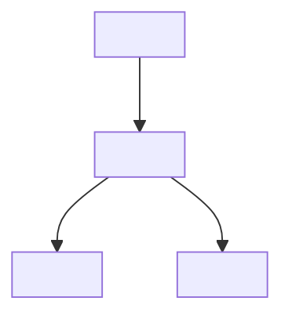

# Product Requirements Document (PRD): {{title}}

Authoring guidance: reuse existing source-backed product material and preserve its professional detail. Scale this document to the actual change; the sections and shared criteria below are prompts, not mandatory application scaffolding. Keep relevant REQ IDs, journeys, security and regression obligations; omit inapplicable examples with a reason rather than inventing features.

Record confirmed facts, assumptions and selected decision rationale from the interview without repeating settled questions. This document joins the interview, applicable design and human task breakdown in the `human-planning` bundle under the [canonical gate protocol](../rules/gates.md). No generated specs precede that approval; implementation requires the later combined `execution` approval. Frontmatter status alone is not approval or evidence.

| Field | Value |
| :--- | :--- |
| Release scope | <In-scope capabilities and operational boundaries; what ships and what is explicitly review-only> |
| Status | Draft for product review; requirements describe the target, not shipped functionality |
| Product owner / approver | <Name or TBD — never invent one> |
| Project / feature | <Module / feature> |
| Prototype / mockup source | <Repository, branch, commit, route, or `N/A — reason`> |
| Screenshot provenance | <Viewport, browser, running environment, capture date, what the images show; or `N/A — reason`> |
| Related technical document | [<Tech Doc>](<relative link>) |

## 1. Executive summary

<2–4 sentences: the problem, who has it, the target outcome, and the most important trade-off. Write for a teammate who did not see the discussion.>

### 1.1 Observed Prototype versus Required Behavior

| Area | Observed current / prototype behavior | Required for this release |
| :--- | :--- | :--- |
| <Area> | <Actual observation or `N/A — reason`> | <Target behavior and boundary> |

### 1.2 UI Changes for Review

<Name the visual authority (branch/commit or existing screens), what stays unchanged, and the screens a reviewer must inspect. State that captures do not prove production behavior. Use `N/A — backend-only change` when true.>

## 2. Problem and evidence

<Plain-language problem, current workaround, impact, and evidence. Separate observed facts from hypotheses and unmeasured baselines. Cite source paths or captures; never invent metrics, incidents or customers.>

## 3. Target Users & Personas

| Persona | Need | Access expectation |
| :--- | :--- | :--- |
| <Role> | <Need and context> | <Read/write/administrative boundary> |

## 4. Goals and measures of success

| Objective | Release measure / observable outcome |
| :--- | :--- |
| <Objective> | <Testable outcome; label proposed targets; no invented numbers> |

## 5. Scope & Requirements

### 5.1 In Scope: Must (Functional Requirements)

- **FR-01** (REQ-001): <Capability with stable requirement ID>
- **FR-02** (REQ-002): <Capability>

### 5.2 Association Model & Save Boundaries

| Record / Entity | Ownership / cardinality | Invariant |
| :--- | :--- | :--- |
| <Record> | <Ownership and cardinality> | <Identity, lifecycle, atomic commit rule> |

### 5.3 Field Inventory & Target Validation

<Complete field inventory when forms or payloads change. Use `N/A — reason` when the change adds no fields.>

| Section / payload | Fields | Target rules and validation |
| :--- | :--- | :--- |
| <Section> | <Fields> | <Required/optional, format, bounds, uniqueness scope> |

### 5.4 Shared Acceptance Criteria

- **AC-S01**: Require an authenticated, authorized context; reject missing/foreign scope without data exposure.
- **AC-S02**: Reject foreign-tenant and cross-boundary identifiers without revealing existence.
- **AC-S03**: Read-only actors cannot mutate through UI or direct operations.
- **AC-S04**: <Change-specific cross-cutting criterion, or justify omission.>
- **AC-S05**: Prevent repeat submission; on failure preserve input and show specific errors.
- **AC-S06**: Mutations that must be atomic commit fully or roll back fully.
- **AC-S07**: Detect stale writes before overwriting newer data.
- **AC-S08**: Programmatic labels, keyboard operation, visible focus and announced errors.
- **AC-S09**: Record actor and time through structured audit; redact sensitive data from logs.
- **AC-S10**: Distinct loading, empty, zero-match and failure states.

### 5.5 Out of Scope

- <Explicit non-goal or deferred capability>
- <Prohibited action, e.g. physical deletion>

## 6. User Journeys, User Stories & Acceptance Criteria

### US-XXX-01: <Story title>

As an <authorized persona>, I want to <action> so that <outcome>.

Page: `<route>` (or `N/A — no user-facing screen`).

Acceptance criteria:

1. **AC-01.1**: <Given, when, then observable outcome.>
2. **AC-01.2**: <Negative, validation or denial outcome.>
3. **AC-01.3**: <Boundary: empty, stale, concurrent or recovery.>

## 7. Assumptions, Risks & Decisions

### 7.1 Product Review Assumptions

| Decision / area | Proposed default | Risk / review needed |
| :--- | :--- | :--- |
| <Decision> | <Rule; label proposals> | <What changes if rejected> |

### 7.2 Dependencies & Implementation Boundaries

| Dependency / risk | Impact | Handling strategy |
| :--- | :--- | :--- |
| <Dependency> | H/M/L | <Isolation, compatibility or fallback guard> |

## 8. Acceptance & Release Checklist

| Verification scenario | Required evidence before release |
| :--- | :--- |
| Functional end-to-end | <REQ IDs and persisted outcomes> |
| Failure and rollback | <Forced failure leaves no partial state> |
| Isolation and access | <Negative cross-tenant and unauthorized cases> |
| Concurrency and recovery | <Crash, retry, stale-write behavior> |
| Compatibility | <Affected existing behavior and regressions> |

### 8.1 Verification Performed for This PRD

- <What was actually inspected or captured, with environment and date.>
- <What remains unrun; never imply verification that did not happen.>

## 9. Related Documents

- [Technical Specification](<relative link>)
- [Task Breakdown](<relative link>)
- <Architecture, ADR or runbook reference>
