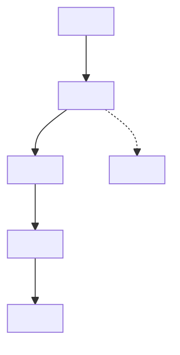
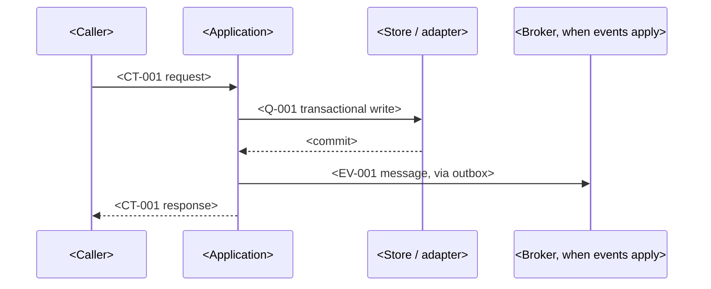

# Technical Document: {{title}}

Authoring guidance: reuse existing architecture/design material and approved interview decisions. Preserve relevant technical detail. Inspect actual callers, tests, contracts and affected regressions before choosing a solution. Every design area below (API, data, events, other) is chosen from the project and the feature, not from this template: fill section 1.2 first, then keep only the sections it marks as applicable and mark the rest `N/A — reason`. The examples are possible concerns, not a required stack or architecture.

**Contract-first:** sections 3 (API) and 4 (events/messages) are the only coupling between backend and frontend, and between producers and consumers. Define every request payload/argument, response, error and message per user journey, with executable example fixtures, before the implementation sections describe how. Backend implements and tests against the contract; frontend mocks the same fixtures; both integrate in staging without waiting on each other. Keep one contract set per PRD user journey so the task breakdown can assign exactly one BE task and one FE task to it.

This design and human milestones join the interview and applicable PRD in the `human-planning` review/approval bundle. Read-only installed-schema preflight may identify decisions early, but generating specs waits for that approval. Derive proposal/specs, complete QA coverage and schema tasks together for `execution` approval before code; link the [canonical gate protocol](../rules/gates.md) rather than adding checkpoints here.

| Field | Value |
| :--- | :--- |
| Feature / scope | <Capabilities, entities and operational boundaries> |
| Target repositories | <Actual repositories, languages and installed versions, with source paths> |
| Author / role | <Role; never invent a person> |
| Product reference | [<PRD>](<relative link>) |
| Architecture references | <Links to current-state architecture and any target plan> |
| Status boundary | <What is observed today versus proposed; no implementation or runtime claim> |

## 1. Summary, Scope and Design Decisions

<2–4 sentences: the technical change, why it is needed, and the main trade-off.>

### 1.1 Core Engineering Principles

Defaults. Delete or replace any that the project's real conventions contradict, and say why.

1. **Lifecycle management:** state transitions over destructive operations; physical deletion only with explicit approval.
2. **Atomic aggregate persistence:** related mutations commit in one transaction; partial commits rejected.
3. **Tenant/company isolation:** runtime isolation at the database layer plus application checks; composite keys prevent pointer hijacking.
4. **Modular architecture:** backend domain → application → adapter; frontend module boundaries; ports owned by consumers.
5. **Replaceable boundaries:** external engines/providers behind narrow ports; no implementation types in domain/application.

### 1.2 Design Decision Record

One row per design area. Record what the repository does today (cite paths) before choosing. "Applies" drives which sections below you fill.

| Design area | Applies? | Chosen approach | Why (evidence from project and request) | Rejected alternatives |
| :--- | :--- | :--- | :--- | :--- |
| API style | <yes / no> | <REST \| GraphQL \| gRPC \| none> | <Existing repo style at `<path>`; what the FE needs; consumers> | <alternative and why not> |
| Relational / document data | <yes / no> | <PostgreSQL tables, document store, none> | <existing schema, access patterns> | <alternative> |
| Events / queue messages | <yes / no> | <broker, topic/queue, webhook, none> | <async need, fan-out, decoupling, retry> | <in-process call, polling> |
| Background jobs / schedules | <yes / no> | <worker, cron, relay> | <long-running or deferred work> | <alternative> |
| Cache / search index | <yes / no> | <store and invalidation rule> | <measured or stated read pressure> | <no cache> |
| External integrations | <yes / no> | <provider behind a port> | <capability not owned here> | <alternative> |
| Frontend | <yes / no> | <module, routes, data adapter> | <PRD screens> | <alternative> |

**How to choose the API style:**

1. Follow the repository's existing style for the same module. Introduce a second style only with a written reason in this table.
2. No precedent: choose **GraphQL** when the FE composes graph-shaped or varying reads from several entities in one screen, or the project already exposes a GraphQL gateway. Choose **REST** for resource-oriented CRUD, public or third-party consumers, file upload/download, webhooks, or when HTTP caching and simple tooling matter. Choose **gRPC** only for internal service-to-service calls where the repository already uses it.
3. State the decision once here. Section 3 then uses only the matching contract variant.

### 1.3 System Context and Boundaries



<Explain trust boundaries, who may call what, and what is explicitly out of the boundary.>

### 1.4 Workflow and Sequence

One diagram per journey that crosses more than one component. Name the CT, Q and EV IDs on the arrows.



## 2. Data Design (Database Schema, ERD, Queries)

Mark the whole section `N/A — reason` when the change touches no stored data. Use the project's real store: the examples below are PostgreSQL; adapt DDL, query syntax and constraints for another engine or a document store.

### 2.1 Existing Schema Baseline

<Inspected migrations, tables, columns, constraints and policies. Cite paths. State what does not exist.>

### 2.2 Entity-Relationship Diagram (Feature Scope)

Show only entities this feature creates or changes, plus the existing entities they reference.

```mermaid
erDiagram
  <ENTITY_A> {
    uuid id PK
    uuid tenant_id FK
  }
  <ENTITY_B> {
    uuid id PK
    uuid <entity_a>_id FK
  }
  <ENTITY_A> ||--o{ <ENTITY_B> : "owns"
```

### 2.3 Data Dictionary

| Table / collection | Column | Type | Null | Default | Constraint / index | Source (REQ / field) |
| :--- | :--- | :--- | :--- | :--- | :--- | :--- |
| `<table>` | `<column>` | <type> | <no> | <value> | <PK, FK, unique scope, check> | <REQ-001 / PRD field> |

### 2.4 Target Tables and Migration Plan

<Proposed DDL, explicitly marked proposed and not applied. Follow the owning repository's migration convention (module order, up-only when that is the policy); do not invent down scripts.>

```sql
-- Proposed migration: <module>/<version>_<name>.up.sql
CREATE TABLE <table> (
  id uuid PRIMARY KEY DEFAULT gen_random_uuid(),
  tenant_id uuid NOT NULL REFERENCES <tenant_table>(id)
);
```

<Privilege/role impact, RLS policy decision, index rationale, and migration ordering with provisioning.>

### 2.5 Query Catalogue

One block per query the application runs. Each query is owned by the single BE task of the journey that calls it and is referenced by its CT ID in section 3.2.

#### Q-001: <query name>

| Field | Value |
| :--- | :--- |
| Caller | <CT-001 / use case> |
| Kind | <read \| write>; <single statement \| inside transaction with Q-00x> |
| Tables | <tables read or written> |
| Access pattern | <expected rows, frequency, sort order, pagination key> |
| Index / plan | <index that serves it; EXPLAIN evidence is `NOT_RUN` until executed> |
| Tenant scope | <predicate or RLS policy that confines it> |
| Error mapping | <e.g. unique violation → `CONFLICT`, zero rows on update → `STALE_WRITE`> |

```sql
-- Proposed; parameterized; not applied
SELECT <columns>
FROM <table>
WHERE tenant_id = $1 AND id = $2;
```

### 2.6 Concurrency Control & Database Safeguards

1. **Compare-and-set / optimistic concurrency:** <exact predicate>.
2. **Locks:** <row/advisory lock keys and ordering>.
3. **Idempotency:** <unique constraints and duplicate suppression>.
4. **Dependency guards:** <what blocks a transition>.
5. **Fail-closed checks:** <what stops startup instead of silently degrading>.

## 3. API Contract Specification (Source of Truth for BE and FE)

Use only the variant selected in section 1.2 (REST or GraphQL; keep both only when the decision record justifies both). Link a machine-readable schema (OpenAPI, SDL, JSON Schema) when the repository has one; do not retype it in a second place. Mark `N/A — no API change` when none applies.

### 3.1 Contract Rules

These rules cover every contract in sections 3 and 4.

1. **Freeze:** a contract is `proposed` until this document is approved, then `frozen`. After freeze only additive changes are allowed (new optional response fields, new error codes the FE already handles by fallback).
2. **Breaking change:** removing/renaming a field, changing a type, nullability, requiredness, enum meaning or error code semantics needs a new contract version, sign-off from the owners on both sides, and updated fixtures. Record it in section 3.5.
3. **Single source:** schema and fixtures live here or at the linked path. Neither team copies expectations into private docs.
4. **Executable fixtures:** the BE contract test and the FE mock read the same fixture files at `<fixture path, e.g. contracts/<slug>/CT-001.*.json>`.
5. **Conventions:** ID format `<uuid>`, timestamps ISO-8601 UTC, money `<representation>`, enums closed with an `<unknown-value handling>` rule, pagination `<cursor|offset>`, nullability stated per field, one error envelope (3.3).

### 3.2 Journey-to-Design Map

One row per PRD user journey: the single traceability table from journey to contract, query, table and message. Each row maps to exactly one BE task and one FE task; both depend only on the contract IDs in the row, never on each other.

| Journey (PRD US ID) | REQ IDs | API contracts | Queries | Tables | Messages | BE task | FE task |
| :--- | :--- | :--- | :--- | :--- | :--- | :--- | :--- |
| US-XXX-01 | REQ-001 | CT-001, CT-002 | Q-001, Q-002 | `<table>` | EV-001 / none | TASK-BE-01 | TASK-FE-01 |

### 3.3 Shared Types and Error Envelope

```
<Shared scalars, enums, pagination and the error envelope used by every contract below>
```

| Error code | Condition | REST status / GraphQL extension code | Required FE behavior |
| :--- | :--- | :--- | :--- |
| `VALIDATION_FAILED` | <field rule violated> | <400 / BAD_USER_INPUT> | <field-level message, keep input> |
| `FORBIDDEN` | <missing permission or foreign tenant; no existence leak> | <403 or 404 / FORBIDDEN> | <denied state> |
| `STALE_WRITE` | <version token mismatch> | <409 / CONFLICT> | <reload prompt, keep input> |

### 3.4 Contract Definitions

Repeat one block per operation. Keep the common table and the matching variant; delete the other variant.

#### CT-001: <operation name>

| Field | Value |
| :--- | :--- |
| Journey / REQ | <US-XXX-01> / <REQ-001> |
| Style | <REST \| GraphQL> |
| Authorization | <role/permission; existing repository directive if any> |
| Idempotency / concurrency | <idempotency key header or version token; N/A — reason> |
| Backed by | <Q-001, Q-002> |
| Emits | <EV-001 or none> |
| Version / status | <v1> / <proposed \| frozen> |

**REST variant**

| Aspect | Value |
| :--- | :--- |
| Method and path | `<POST /v1/<resource>>` |
| Headers | <auth, `Idempotency-Key`, `If-Match`, tenant header> |
| Path / query parameters | <name, type, required, validation> |
| Success status | <201 / 200 / 204> |
| Error statuses | <400, 401, 403, 404, 409, 422 and which error code each carries> |

**GraphQL variant**

```graphql
# Proposed; exact signatures
extend type Mutation {
  <mutation>(input: <Input>!): <Payload>! <existing repository authorization directive, if applicable>
}
```

Nullability, breaking removals/renames and caller impact: <state each>.

**Request body / input fields**

| Field | Type | Required | Validation | Notes |
| :--- | :--- | :--- | :--- | :--- |
| `<field>` | <type> | <yes/no> | <format, bounds, uniqueness scope> | <default, example> |

**Response**

| Field | Type | Nullable | Notes |
| :--- | :--- | :--- | :--- |
| `<field>` | <type> | <yes/no> | <meaning, ordering, derived or stored> |

**Errors:** <error codes from 3.3 plus operation-specific codes, each with condition>.

**Example fixtures** (consumed by the BE contract test and the FE mock; one file per case):

```json
// success: request
{ }
// success: response
{ }
// validation error: response
{ }
// forbidden, stale write, empty/zero-match: add a response per applicable case
```

### 3.5 Contract Change Log

Covers API and message contracts.

| Version | Date | Contract IDs | Change (additive or breaking) | Sign-off (both sides) |
| :--- | :--- | :--- | :--- | :--- |
| v1 | {{date}} | <IDs> | Initial freeze | <owner roles; never invent a person> |

## 4. Events and Queue Messages

Mark the whole section `N/A — no events or queues` when section 1.2 says they do not apply. Define every message a producer sends and a consumer reads, including webhooks and queue jobs, with the same freeze and fixture rules as section 3.1.

### 4.1 Messaging Topology

| Channel (topic / queue / webhook) | Type | Broker / transport | Partition or ordering key | Producer | Consumers | Guarantee | Retry / DLQ | Retention |
| :--- | :--- | :--- | :--- | :--- | :--- | :--- | :--- | :--- |
| `<domain.entity.event>` | <topic \| queue \| stream \| webhook> | <product and installed version> | <aggregate id> | <module> | <modules/services> | <at-least-once \| at-most-once> | <backoff, max attempts, dead-letter target> | <duration> |

Publishing consistency: <transactional outbox + relay, or why a direct publish is acceptable; what happens when the commit succeeds and the publish fails>.

### 4.2 Message Contract Definitions

Repeat one block per message type.

#### EV-001: <message name>

| Field | Value |
| :--- | :--- |
| Channel | <channel from 4.1> |
| Trigger | <state change or contract operation (CT-001) that emits it> |
| Consumers and action | <consumer → what it does; per-consumer failure handling> |
| Idempotency key | <message id or aggregate id + version; consumer dedupe store> |
| Ordering | <per-key order required or not; out-of-order handling> |
| Retry / poison handling | <backoff, max attempts, DLQ, operator recovery> |
| Version / status | <v1> / <proposed \| frozen> |

**Envelope and payload**

| Field | Type | Required | Notes |
| :--- | :--- | :--- | :--- |
| `message_id` | uuid | yes | unique per message; idempotency key |
| `type` / `version` | string / int | yes | `<EV-001>` / `1` |
| `occurred_at` | ISO-8601 UTC | yes | event time, not publish time |
| `tenant_id` | uuid | yes | consumers MUST scope by it |
| `correlation_id` | uuid | yes | from the originating request |
| `data.<field>` | <type> | <yes/no> | <meaning; no sensitive data unless justified> |

```json
// one valid example, plus one example per consumer-visible variant (e.g. deleted, updated)
{ }
```

## 5. Other Design Concerns

Include only rows marked applicable in section 1.2; delete the rest.

| Concern | Design (chosen approach, paths, configuration) | Failure and recovery |
| :--- | :--- | :--- |
| Background jobs / schedules | <worker, trigger, execution identity, concurrency limit> | <retry, ambiguity policy, operator recovery> |
| Cache / search index | <key, TTL, invalidation trigger, source of truth> | <stale read policy, rebuild> |
| External integrations | <provider, port, auth, rate limits, timeouts> | <circuit breaker, fallback, idempotent retry> |
| File / object storage | <bucket, key scheme, access control, size limits> | <orphan cleanup> |
| Configuration / feature flags | <keys, defaults, who toggles> | <safe default> |
| Observability | <structured logs, metrics, traces, alerts; sensitive fields redacted> | <what alerts and who responds> |
| Performance / capacity | <stated targets or `no baseline`; never invent numbers> | <degradation behavior> |

## 6. Backend Implementation Architecture

### 6.1 Service Layer

<Use cases, transaction boundaries, authorization, validation, audit and failure classification. Cite real paths.>

One use case set per journey, owned by that journey's single BE task. Validate every request against its section 3.4 schema at the transport boundary and return only shapes that match the contract fixtures; any other response shape is a defect, not an implementation choice.

### 6.2 Adapters and Queries

<Repository/adapter contracts, which Q-IDs each adapter implements, parameterized SQL, generated-query ownership, error mapping and driver isolation.>

### 6.3 Message Producers and Consumers

<Where each EV-ID is published (outbox write, relay) and consumed (handler, idempotency store, retry wiring). `N/A — reason` when section 4 is N/A.>

### 6.4 Background Execution and Operations

<When applicable: worker lifecycle, execution identity, shutdown, operator recovery, retention. Otherwise `N/A — reason`.>

## 7. Frontend Architecture & Modular Integration

### 7.1 Route Mapping and Adapters

<Routes owned by which module, data source (API vs fixture), and cutover impact.>

Each contract is consumed through one data-access adapter or hook typed from section 3.4. The adapter has a `mock | real` switch (`<env var or config key>`) with `mock` returning the section 3.4 fixtures, so the journey's single FE task can build and test the whole flow before the backend exists. No hand-written types or payloads outside the contract. Server-pushed messages the UI consumes (websocket, SSE) use the section 4.2 payloads the same way.

### 7.2 Component Architecture & UX Standards

<Screens/components changed, loading/empty/error behavior, accessibility, and what must not change.>

## 8. Multi-Tenant Security & Permission Guards

<Database isolation, application authorization, privileged versus restricted pools, worker/operator authority, message-consumer tenant scoping, sensitive-data handling in payloads, messages and logs.>

| Risk | Prevention / recovery | Verification obligation |
| :--- | :--- | :--- |
| <Risk> | <Control> | <Negative and positive check> |

## 9. Verification & Testing Strategy

### 9.1 Backend Automated Verification

```
<Repository-supported command and required environment; use a container only if project policy requires it>
```

<Transactional, concurrency, isolation, failure-injection and recovery cases; message publish/consume, duplicate delivery and DLQ cases when section 4 applies. Mark every check `NOT_RUN` until executed.>

### 9.2 Frontend Automated Verification

```
<exact command>
```

<Contract/type/component checks and actual changed-flow Playwright smoke, including error states, keyboard/focus and relevant viewports. Mark unavailable browser evidence BLOCKED, not simulated PASS.>

Coordinate targeted author checks at stable checkpoints without racing shared edits. These results do not replace separate final QA and reviewer runs or risk-required security specialist evidence. Record actual commands/exits and current-source results in `verification.md`; required FAIL/BLOCKED/NOT_RUN prevents a review-ready handoff.

### 9.3 Contract Verification and Staging Integration

| Layer | Check | Owner |
| :--- | :--- | :--- |
| BE contract test | Each section 3.4 request fixture is accepted/rejected as specified and the real response matches the response fixture shape, including every error fixture; each section 4.2 message the BE produces matches its payload example | BE task |
| FE mock test | Component/flow tests and Playwright run against the `mock` adapter using the same fixtures, including loading, empty, error and stale-write states | FE task |
| Staging integration | Flip the adapter to `real`; rerun the FE flow and compare real responses with fixtures; any diff is a contract change under 3.1 | QA task |

```
<repository-supported contract test command>
<repository-supported FE mock-mode command>
```

Mark every check `NOT_RUN` until executed.

## 10. Rollout, Rollback and Open Decisions

| Phase / decision | Action or question | Evidence or blocking status |
| :--- | :--- | :--- |
| Prepare | <dependency, migration, provisioning order; topics/queues created before producers deploy> | <readiness signal> |
| Prepare | Freeze section 3 and 4 contracts and commit fixtures | Owners on both sides sign off in 3.5 |
| Roll out | BE ships behind the contract; FE ships with adapter on `mock` or the feature hidden until BE is live in staging | Contract tests PASS on both sides, then staging flip |
| Roll out | <ordering and operator action; consumers before producers for new message types> | <health/correctness signal> |
| Roll back | <recovery steps and data limits; in-flight messages and DLQ handling> | <restored state> |
| Open decision | <unresolved choice> | <blocking? owner> |

## 11. Related Documents

- [PRD](<relative link>)
- [Task Breakdown](<relative link>)
- <Runbook / architecture reference>
