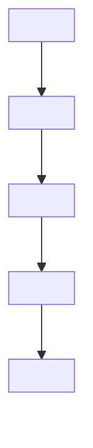
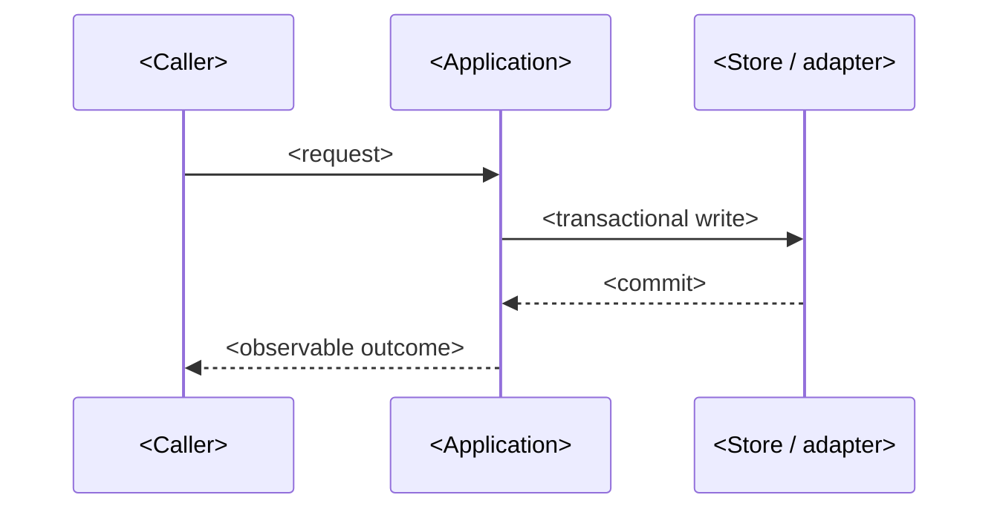

# Technical Document: {{title}}

Authoring guidance: reuse existing architecture/design material and approved interview decisions. Preserve relevant technical detail; adapt or omit inapplicable database, GraphQL, tenant, backend/frontend and diagram sections with reasons. The examples describe possible concerns, not a required stack or architecture. Inspect actual callers, tests, contracts and affected regressions before choosing a solution.

This design and human milestones join the interview and applicable PRD in the `human-planning` review/approval bundle. Read-only installed-schema preflight may identify decisions early, but generating specs waits for that approval. Derive proposal/specs, complete QA coverage and schema tasks together for `execution` approval before code; link the [canonical gate protocol](../rules/gates.md) rather than adding checkpoints here.

| Field | Value |
| :--- | :--- |
| Feature / scope | <Capabilities, entities and operational boundaries> |
| Target repositories | <Actual repositories, languages and installed versions, with source paths> |
| Author / role | <Role; never invent a person> |
| Product reference | [<PRD>](<relative link>) |
| Architecture references | <Links to current-state architecture and any target plan> |
| Status boundary | <What is observed today versus proposed; no implementation or runtime claim> |

## 1. Summary and Scope

<2–4 sentences: the technical change, why it is needed, and the main trade-off.>

### 1.1 Core Engineering Principles

1. **Lifecycle management:** state transitions over destructive operations; physical deletion only with explicit approval.
2. **Atomic aggregate persistence:** related mutations commit in one transaction; partial commits rejected.
3. **Tenant/company isolation:** runtime isolation at the database layer plus application checks; composite keys prevent pointer hijacking.
4. **Modular architecture:** backend domain → application → adapter; frontend module boundaries; ports owned by consumers.
5. **Replaceable boundaries:** external engines/providers behind narrow ports; no implementation types in domain/application.

### 1.2 System Context and Boundaries



<Explain trust boundaries, who may call what, and what is explicitly out of the boundary.>

### 1.3 Workflow and Sequence



### 1.4 Entity-Relationship Diagram (Feature Scope)

```mermaid
erDiagram
  <ENTITY_A> {
    uuid id PK
    uuid tenant_id FK
  }
  <ENTITY_B> {
    uuid id PK
    uuid <entity_a>_id FK
  }
  <ENTITY_A> ||--o{ <ENTITY_B> : "owns"
```

## 2. Database Schema & Migrations

### 2.1 Existing Schema Baseline

<Inspected migrations, tables, columns, constraints and policies. Cite paths. State what does not exist.>

### 2.2 Target Tables and Migration Plan

<Proposed DDL, explicitly marked proposed and not applied. Follow the owning repository's migration convention (module order, up-only when that is the policy); do not invent down scripts.>

```sql
-- Proposed migration: <module>/<version>_<name>.up.sql
CREATE TABLE <table> (
  id uuid PRIMARY KEY DEFAULT gen_random_uuid(),
  tenant_id uuid NOT NULL REFERENCES <tenant_table>(id)
);
```

<Privilege/role impact, RLS policy decision, index rationale, and migration ordering with provisioning.>

### 2.3 Concurrency Control & Database Safeguards

1. **Compare-and-set / optimistic concurrency:** <exact predicate>.
2. **Locks:** <row/advisory lock keys and ordering>.
3. **Idempotency:** <unique constraints and duplicate suppression>.
4. **Dependency guards:** <what blocks a transition>.
5. **Fail-closed checks:** <what stops startup instead of silently degrading>.

## 3. GraphQL API Specification

### 3.1 Queries

```graphql
extend type Query {
  <query>(<args>): <Type> <existing repository authorization directive, if applicable>
}
```

### 3.2 Mutations

```graphql
extend type Mutation {
  <mutation>(input: <Input>!): <Payload>! <existing repository authorization directive, if applicable>
}
```

<Document removals/renames as breaking, error semantics, nullability and caller impact. Mark `N/A — reason` when there is no API change.>

## 4. Backend Implementation Architecture

### 4.1 Service Layer

<Use cases, transaction boundaries, authorization, validation, audit and failure classification. Cite real paths.>

### 4.2 Adapters and Queries

<Repository/adapter contracts, parameterized SQL, generated-query ownership, error mapping and driver isolation.>

### 4.3 Background Execution and Operations

<When applicable: enqueue/relay/worker lifecycle, execution identity, retry and ambiguity policy, shutdown, operator recovery, retention. Otherwise `N/A — reason`.>

## 5. Frontend Architecture & Modular Integration

### 5.1 Route Mapping and Adapters

<Routes owned by which module, data source (API vs fixture), and cutover impact.>

### 5.2 Component Architecture & UX Standards

<Screens/components changed, loading/empty/error behavior, accessibility, and what must not change.>

## 6. Multi-Tenant Security & Permission Guards

<Database isolation, application authorization, privileged versus restricted pools, worker/operator authority, sensitive-data handling in payloads and logs.>

| Risk | Prevention / recovery | Verification obligation |
| :--- | :--- | :--- |
| <Risk> | <Control> | <Negative and positive check> |

## 7. Verification & Testing Strategy

### 7.1 Backend Automated Verification

```
<Repository-supported command and required environment; use a container only if project policy requires it>
```

<Transactional, concurrency, isolation, failure-injection and recovery cases. Mark every check `NOT_RUN` until executed.>

### 7.2 Frontend Automated Verification

```
<exact command>
```

<Contract/type/component checks and actual changed-flow Playwright smoke, including error states, keyboard/focus and relevant viewports. Mark unavailable browser evidence BLOCKED, not simulated PASS.>

Coordinate targeted author checks at stable checkpoints without racing shared edits. These results do not replace separate final QA and reviewer runs or risk-required security specialist evidence. Record actual commands/exits and current-source results in `verification.md`; required FAIL/BLOCKED/NOT_RUN prevents a review-ready handoff.

## 8. Rollout, Rollback and Open Decisions

| Phase / decision | Action or question | Evidence or blocking status |
| :--- | :--- | :--- |
| Prepare | <dependency, migration, provisioning order> | <readiness signal> |
| Roll out | <ordering and operator action> | <health/correctness signal> |
| Roll back | <recovery steps and data limits> | <restored state> |
| Open decision | <unresolved choice> | <blocking? owner> |

## 9. Related Documents

- [PRD](<relative link>)
- [Task Breakdown](<relative link>)
- <Runbook / architecture reference>
